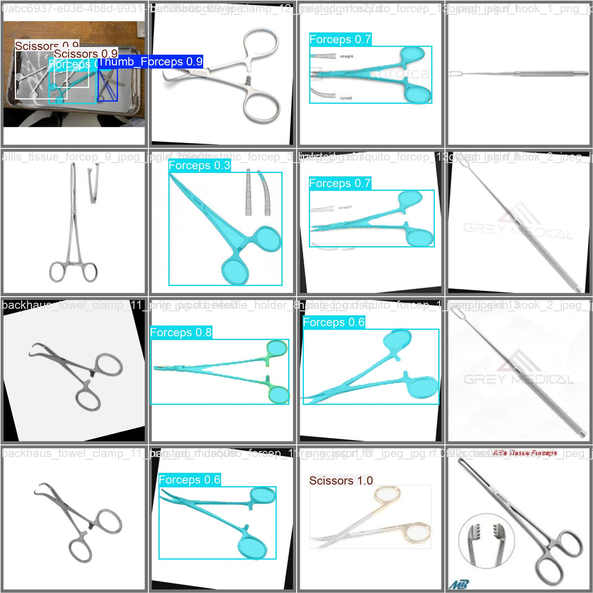
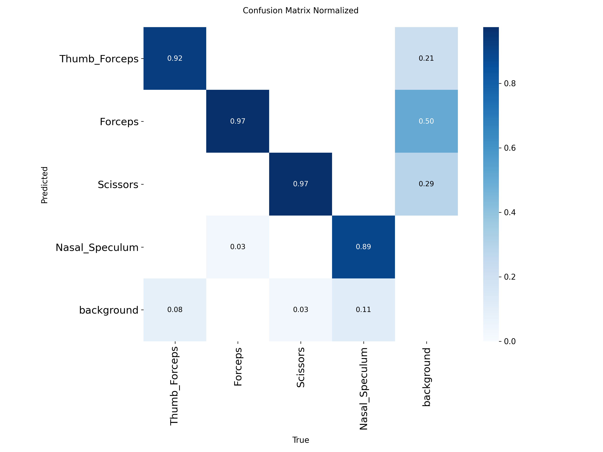

# Automated Surgical Instrument Identification and Counting System

[](LICENSE)

This system counts the surgical instruments on a tray before and after a procedure and flags any that are missing. A GoPro camera streams the tray to a **YOLO11m-seg** instance segmentation model, which identifies and counts four instrument classes. An Arduino-controlled tray shakes the instruments apart between detection passes, and a load-cell scale double-checks the result by weight.

| Class ID | Class |
|---|---|
| 0 | Thumb_Forceps |
| 1 | Forceps |
| 2 | Scissors |
| 3 | Nasal_Speculum |

## How it works

```
GoPro (UDP stream) ──► gopro_inference.py ──► YOLO11m-seg ──► per-class counts ─┐
                                                                              ├─► ui.py (Tkinter GUI)
Arduino: 4× HX711 load cells + shaker motor ◄── serial (115200) ──────────────┘
```

1. **Initial detection.** The GUI records the tray weight. It then runs five rounds of *shake the tray for 5 s, then count the instruments*, and keeps the most frequent count for each class as the baseline.
2. **Final detection.** The same sequence runs again after the procedure. Any class with fewer instruments than the baseline is marked **MISSING**. If the camera finds nothing missing but the tray has lost more than 20 g, the GUI raises a weight alert instead.

## Repository layout

```
├── app/
│   ├── ui.py                    GUI: camera feed, detection workflow, Arduino control
│   └── gopro_inference.py       GoPro capture + YOLO inference (also runs standalone)
├── scripts/
│   ├── data_download.py         Download the raw MDP dataset from Roboflow (COCO)
│   ├── data_prepare.py          Merge into 4 classes, COCO → YOLO-seg, add background negatives
│   ├── train.py                 Train YOLO11m-seg, then evaluate on the test split
│   ├── resume.py                Resume training from last.pt
│   └── predict.py               Batch inference on data/predict/
├── firmware/tray_controller/
│   └── tray_controller.ino      Arduino: load-cell weighing + shaker motor
├── data/
│   ├── MDP-Dataset_accessary-2/ Raw Roboflow export (COCO)
│   ├── yolo_surgical_dataset/   Prepared YOLO dataset (train 1157 / valid 92 / test 68 images)
│   ├── backgrounds/             GoPro frames without instruments (negative samples)
│   └── predict/                 GoPro test images + output/ with annotated predictions
└── runs/segment/
    ├── train/                   Training curves, results.csv, weights/best.pt
    └── val/                     Test-split evaluation plots
```

## Installation

Requires Python 3.10+ and an NVIDIA GPU with CUDA.

```bash
pip install -r requirements.txt
```

On Windows, install `pycocotools-windows` instead of `pycocotools`.

## Usage

All commands are run from the repository root.

### Run the full system

```bash
python app/ui.py
```

Before you start:

- Flash `firmware/tray_controller/tray_controller.ino` to the Arduino. It needs the HX711 library.
- Connect the GoPro over USB in webcam mode. Its IP address is set by `GOPRO_IP` in [app/gopro_inference.py](app/gopro_inference.py).
- In the GUI, select the Arduino's COM port and click **CONNECT**. Then press **INITIAL DETECTION**, and later **FINAL DETECTION**.

To view the camera feed with live segmentation and no GUI:

```bash
python app/gopro_inference.py
```

### Batch prediction on images

Put images in `data/predict/` and run:

```bash
python scripts/predict.py
```

The annotated images are saved to `data/predict/output/`.

### Rebuild the dataset and retrain

The prepared dataset is already included, so you only need these steps to rebuild it from scratch.

```bash
export ROBOFLOW_API_KEY=<your key>          # PowerShell: $env:ROBOFLOW_API_KEY="<your key>"
python scripts/data_download.py
python scripts/data_prepare.py
python scripts/train.py                     # 60 epochs, 640 px, batch 16
```

## Results

These are validation metrics for `best.pt`, epoch 60:

| | Precision | Recall | mAP50 | mAP50-95 |
|---|---|---|---|---|
| Box | 0.885 | 0.940 | 0.971 | 0.881 |
| Mask | 0.874 | 0.893 | 0.905 | 0.591 |

<p>
  
  
</p>

The full training curves are in [runs/segment/train/](runs/segment/train/).

## License

This project is released under the [Creative Commons Attribution-NonCommercial 4.0 International License (CC BY-NC 4.0)](LICENSE). You may use, modify and share it for **personal, academic and research purposes** if you give appropriate credit. **Commercial use is not permitted.**

Third-party terms also apply:

- `runs/segment/train/weights/best.pt` is fine-tuned from [Ultralytics YOLO11](https://github.com/ultralytics/ultralytics), so it is also subject to the Ultralytics license (AGPL-3.0).
- The raw dataset comes from the Roboflow project `ziyans-workspace/mdp-dataset_accessary` and remains subject to its original license.
